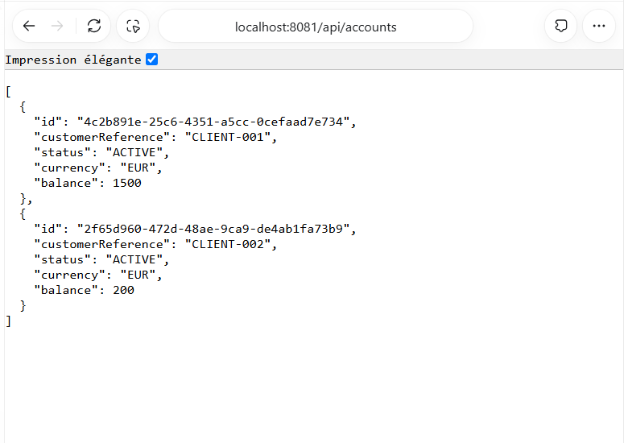
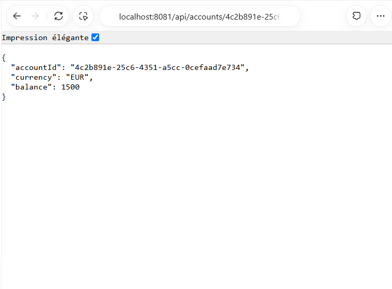
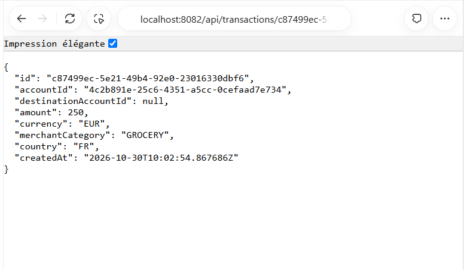
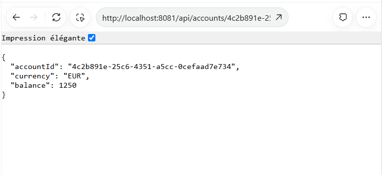

# Étape 2 — Services métier et API REST

## Réponse courte pour le rapport

Les deux microservices sont organisés en couches domain, repository, service
et web/rest. Les entités BankAccount et BankTransaction sont persistées avec
Spring Data JPA dans deux bases H2 distinctes. Les contrôleurs REST délèguent
les opérations à la couche service, qui sera également appelée par GraphQL
et MCP. Les données d'entrée sont validées au niveau REST et au niveau service.

Avant une transaction, transaction-service vérifie le montant et le plafond
configuré, puis consulte le compte et son solde via OpenFeign. Il vérifie que
le compte est actif, que la devise correspond et que le solde est suffisant.
Il persiste ensuite la transaction avant d'appeler account-service pour le débit.
Une exception pendant cet appel provoque le rollback de la transaction locale.

Un virement contient le compte source et le compte destinataire. Les deux
comptes doivent être actifs et utiliser la devise de l'opération. Le débit et
le crédit sont effectués dans une seule transaction locale d'account-service,
avec verrouillage des comptes dans un ordre stable. L'historique permet de
retrouver le virement depuis le compte source ou le compte destinataire.

## Explication avec mes mots

Chaque service garde ses propres données. Transaction-service demande les
informations du compte à account-service plutôt que d'accéder directement à
sa base. Les règles sont centralisées dans les services pour obtenir le même
comportement avec les futurs connecteurs REST, GraphQL et MCP.

## Choix et limites à expliquer à l'oral

- Le solde est un double, conformément au modèle minimal du PDF. Les calculs
  intermédiaires utilisent BigDecimal.valueOf pour limiter les erreurs usuelles
  d'addition et de soustraction. Un double conserve une précision limitée ;
  dans une application bancaire réelle, un solde BigDecimal serait préférable.
- Le montant d'une transaction est un BigDecimal, stocké en DECIMAL(38,12).
  Les entrées de plus de 12 décimales sont rejetées pour éviter un arrondi
  silencieux à la persistance. Une mise à jour de solde qui perdrait de la
  précision lors de sa conversion en double est également rejetée.
- Le découvert n'est pas autorisé dans cette implémentation.
- Une transaction ordinaire représente un débit. Un virement débite la source
  et crédite la destination ; destinationAccountId est ajouté au modèle minimal.
- Les bases H2 sont en mémoire : les données sont réinitialisées à l'arrêt.
- Le plafond vaut 1000 localement à cette étape. Le Config Server le partagera
  à l'étape 3. Le client Feign est déjà utilisable avec une URL directe.
- Un @Transactional ne crée pas de transaction distribuée entre les deux bases.
  Une perte de réponse après un débit réussi ou un échec du commit local peut
  laisser une incohérence. Il faut alors vérifier les données ; ne pas relancer
  aveuglément une écriture. Une garantie distribuée complète demanderait un
  mécanisme de reprise/idempotence supplémentaire, hors de cette étape.
- Les endpoints de débit et de transfert d'account-service servent à la
  communication interservices. Ils ne constituent pas une nouvelle transaction
  dans transaction-service ; les tests métier passent par transaction-service.
- Kafka, MCP, GraphQL et la tolérance aux pannes ne sont pas encore réalisés.

## Préparer les captures — à réaliser par le candidat

Aucune capture n'est produite automatiquement. Après compilation, ouvrir
deux terminaux à la racine du dépôt et lancer :

```powershell
# Terminal 1
java -jar account-service/target/account-service-0.0.1-SNAPSHOT.jar
```

```powershell
# Terminal 2
java -jar transaction-service/target/transaction-service-0.0.1-SNAPSHOT.jar
```

Utiliser le client REST habituel avec les requêtes du fichier
`etape-02-rest.http`. Remplacer les variables SOURCE et DESTINATION par les
UUID reçus lors de la création des comptes.

| Capture | Action et éléments à rendre visibles | Résultat attendu |
| --- | --- | --- |
| 02-01-comptes.png | POST de chacun des deux comptes : URL, JSON envoyé, statut et réponse avec UUID | 201 ; soldes 1500 et 200 EUR |
| 02-02-solde-avant.png | GET du solde du compte source avant toute transaction | 1500 EUR |
| 02-03-transaction.png | POST d'une transaction de 250 EUR : URL, JSON, statut et réponse | 201, UUID de transaction et date |
| 02-04-solde-apres.png | GET du solde du compte source après la transaction | 1250 EUR |
| 02-05-plafond.png | POST d'une transaction de 1000.01 EUR | 409, détail du rejet, solde inchangé |
| 02-06-montant-invalide.png | POST d'une transaction de montant 0 | 400, erreur de validation |
| 02-07-devise.png | POST d'une transaction en MAD sur le compte EUR | 409, Currency mismatch |
| 02-08-virement.png | POST du virement de 100 EUR de SOURCE vers DESTINATION | 201 avec les deux UUID |
| 02-09-soldes-virement.png | GET des deux soldes après ce virement | source 1150 EUR, destination 300 EUR |
| 02-10-compte-bloque.png | PATCH du statut source vers BLOCKED, puis POST d'une transaction | 409, Account is blocked |
| 02-11-tests.png | Résultat Maven avec compteurs de tests et BUILD SUCCESS | Aucun échec |

Les soldes attendus supposent que chaque opération acceptée a été exécutée
une seule fois, dans cet ordre. En cas de répétition, recréer des comptes
et utiliser leurs nouveaux UUID. Ne pas réutiliser une ancienne capture.

## Intégration au rapport final

Les captures sont à fournir par le candidat. Leurs noms ci-dessus permettent
de les associer aux paragraphes et aux légendes du rapport PDF final.
Les résultats des tests automatisés seront conservés dans
`verification-etape-02.txt` et `verification-etape-02-rest.json` après exécution.

## Vérifications réalisées
- Maven package : BUILD SUCCESS pour le parent et les six modules.
- 22 tests automatisés : aucun échec, aucune erreur et aucun test ignoré.
- Test entre les deux JAR avec un vrai client OpenFeign : 19 requêtes HTTP
  réussies, dont un débit, un virement et des rejets métier.
- Le solde source passe de 1500 à 1250 EUR après un débit de 250 EUR.
- Après un virement de 100 EUR, les soldes sont de 1150 et 300 EUR.
- L'arrêt d'account-service entraîne un HTTP 503 et aucune transaction
  supplémentaire dans l'historique. Ce test ne valide pas encore Resilience4J.
- Les applications du test ont été arrêtées. Les relancer avec les commandes
  ci-dessus pour réaliser les captures manuelles.
- Le diagramme de classes correspondant au code est dans diagramme-classes.mmd.

### Capture reçue : consultation des comptes

Figure 02-01 — La requête GET /api/accounts retourne les deux comptes actifs et leurs soldes initiaux.


### Capture reçue : solde avant transaction

Figure 02-02 — Consultation du solde du compte source avant l'enregistrement de la transaction : 1500 EUR.


### Capture reçue : consultation de la transaction créée

Figure 02-03 — Consultation par GET de la transaction précédemment créée : montant de 250 EUR, compte source et date. Cette capture montre la lecture du résultat ; le statut HTTP 201 du POST a été vérifié séparément.


### Capture reçue : solde après transaction

Figure 02-04 — Après le débit de 250 EUR, le solde passe de 1500 à 1250 EUR.

