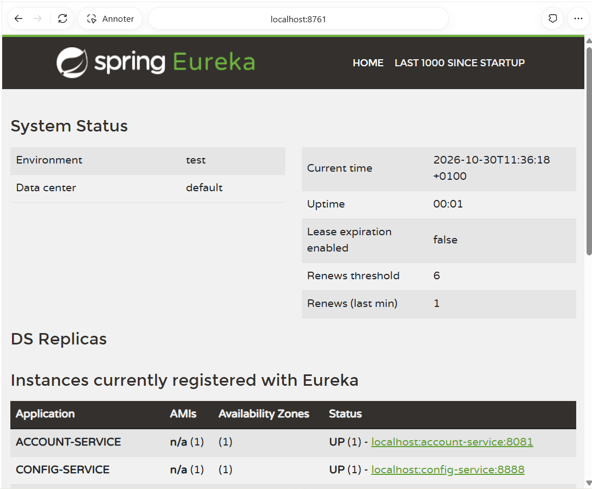
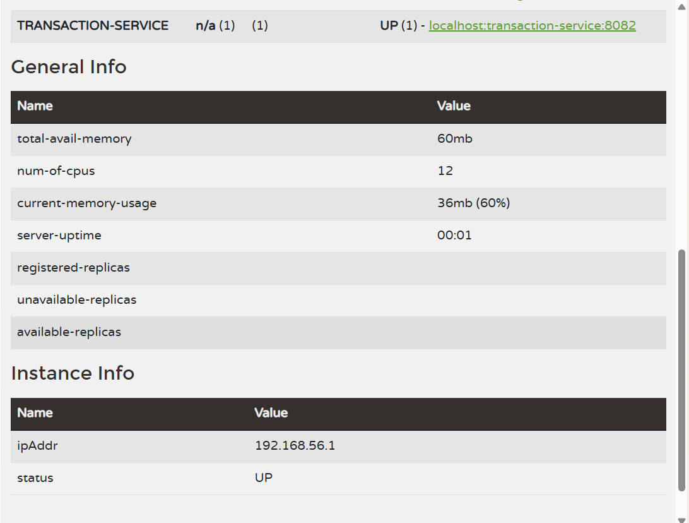
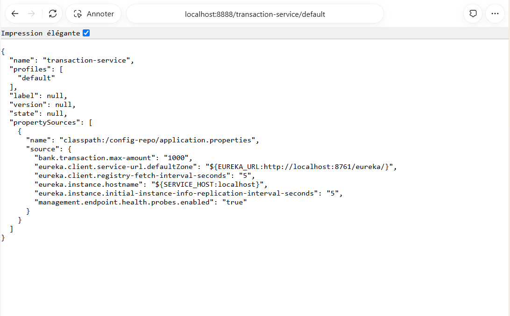

# Étape 3 — Eureka, Config Server et Resilience4J

## Réponse pour le rapport

Eureka centralise l'enregistrement et la découverte des services. Le client
OpenFeign utilise le nom account-service, résolu avec Spring Cloud LoadBalancer
à partir d'Eureka. ACCOUNT_SERVICE_URL permet toujours un test avec URL directe.

Le Config Server utilise le profil native et charge les propriétés partagées
depuis classpath:/config-repo. Il partage bank.transaction.max-amount=1000.
Les services métier importent cette configuration au démarrage : le Config
Server est requis et le plafond n'est plus dupliqué dans transaction-service.

Resilience4J protège les appels Feign. Une lecture en échec transitoire peut
effectuer jusqu'à trois tentatives. Le circuit ouvre à partir de 50 % d'échecs,
après au moins trois appels logiques dans une fenêtre de six appels. Il passe
en HALF_OPEN après dix secondes et autorise deux appels d'essai. Les erreurs
métier HTTP 4xx ne sont ni répétées ni comptabilisées comme des pannes.

Le fallback renvoie HTTP 503 avec operation not confirmed. Il ne fabrique ni
compte ni solde. Les écritures de débit et de virement ne sont pas répétées
automatiquement, pour éviter une double écriture après une réponse perdue.
Les tentatives d'une lecture comptent pour un seul appel logique du circuit.

## Explication courte avec mes mots

Eureka indique où joindre chaque service. Config Server fournit les paramètres
communs. Feign effectue les appels HTTP. Le retry traite une panne passagère
pendant une lecture ; le circuit breaker évite d'insister sur un service en
panne. Le fallback signale alors une erreur sans annoncer un faux succès.

## Démarrage local

Depuis la racine du dépôt, utiliser un terminal par commande, dans cet ordre :

```powershell
java -jar discovery-service/target/discovery-service-0.0.1-SNAPSHOT.jar
java -jar config-service/target/config-service-0.0.1-SNAPSHOT.jar
java -jar account-service/target/account-service-0.0.1-SNAPSHOT.jar
java -jar transaction-service/target/transaction-service-0.0.1-SNAPSHOT.jar
```

Attendre le démarrage de l'infrastructure avant les services métier. Les bases
H2 restent en mémoire : recréer des comptes après le redémarrage. Arrêter les
applications avant de reconstruire leurs JAR sous Windows.

## Captures à prendre par le candidat

| Fichier | Écran | Éléments à rendre visibles |
| --- | --- | --- |
| 03-01-eureka.png | http://localhost:8761 | ACCOUNT-SERVICE, TRANSACTION-SERVICE et CONFIG-SERVICE enregistrés, état UP |
| 03-02-config.png | http://localhost:8888/transaction-service/default | URL, propertySources et bank.transaction.max-amount=1000 |
| 03-03-feign.png | POST /api/transactions, sans ACCOUNT_SERVICE_URL | Réponse 201 et solde débité, communication par découverte Eureka |
| 03-04-fallback.png | Arrêter account-service puis envoyer une transaction | Réponse 503, operation not confirmed, historique inchangé |
| 03-05-circuit.png | http://localhost:8082/actuator/circuitbreakerevents | Transition vers OPEN après plusieurs requêtes en échec |
| 03-06-retry.png | http://localhost:8082/actuator/retryevents et logs transaction-service | Tentatives de lecture et activation du fallback |
| 03-07-tests.png | Résumé Maven | Tests sans échec, sept modules SUCCESS et BUILD SUCCESS |

Pour observer OPEN, envoyer rapidement plusieurs transactions après l'arrêt
d'account-service, en conservant Eureka et Config Server actifs. Le nombre
d'échecs nécessaire dépend des appels précédents dans la fenêtre. Les événements
Actuator sont réinitialisés au redémarrage. Redémarrer le compte ensuite et
recréer les données de test si nécessaire.

## Limites

Le fallback ne crée pas de transaction distribuée entre les bases. Une réponse
d'écriture perdue nécessite une vérification. Le plafond est chargé au démarrage ;
le refresh dynamique n'est pas ajouté. Les secrets restent hors du Config Server.
Les tests automatisés isolés désactivent Config Client et Eureka ; un test HTTP
séparé vérifie les quatre applications et la découverte réelle.

## Références

- [Backend native du Config Server](https://docs.spring.io/spring-cloud-config/reference/server/environment-repository/file-system-backend.html)
- [Resilience4J avec Spring Boot](https://resilience4j.readme.io/docs/getting-started-3)

## Vérifications réalisées
Le build Maven réussit pour les sept projets. Les 26 tests passent. Le test
HTTP des quatre JAR valide Config Server, Eureka, Feign sans URL directe, le
plafond 1000, les retries, le circuit OPEN, le fallback 503 et l'absence
d'enregistrement supplémentaire lors de la panne. Les résultats sont conservés
dans verification-etape-03.txt et verification-etape-03-rest.json.


## Captures reçues : registre Eureka

Figure 03-01a — Dashboard Eureka avec account-service et config-service en état UP.


Figure 03-01b — Suite du registre : transaction-service est également en état UP.


### Capture reçue : configuration centralisée

Figure 03-02 — Le Config Server expose la configuration commune et le plafond de 1000 pour transaction-service.

