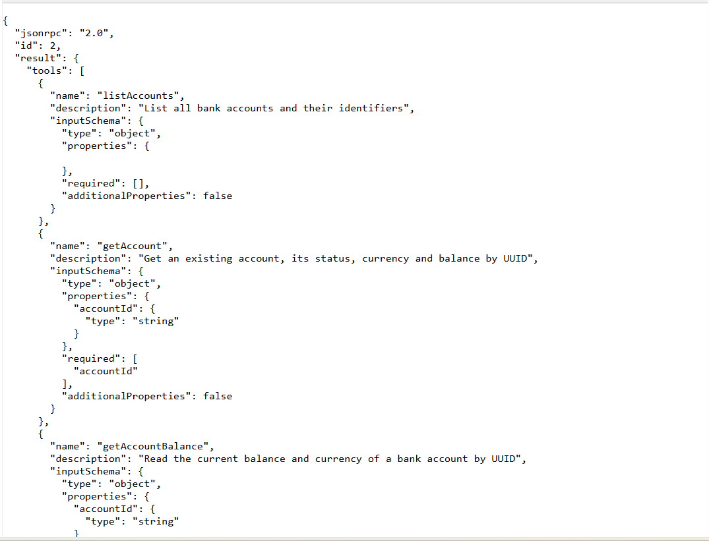
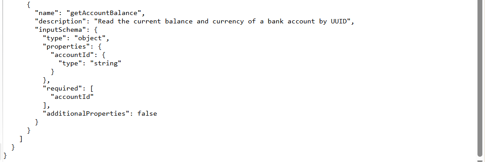

# Étape 4 — Kafka et serveurs MCP

## Réponse pour le rapport

Après validation et enregistrement d'une transaction, la couche service émet
un événement TransactionCreated. Un listener AFTER_COMMIT ne le transmet à Kafka
qu'après le commit JPA réussi. Le topic est bank.transactions.created et la
clé du message est l'UUID accountId sous forme de chaîne. Le JSON contient
eventId, eventType, transactionId, accountId, amount, currency et occurredAt.
Les virements produisent également un événement, avec le compte source comme clé.

Le consumer est intégré à transaction-service, dans un groupe de consommation
dédié. Il journalise le topic, la clé et le JSON reçu. Il ne modifie ni compte,
ni solde, ni transaction. Le topic possède trois partitions et une réplication
de un pour cette démonstration locale. La clé accountId conserve le même
partitionnement pour les événements d'un même compte.

Chaque service métier expose un véritable endpoint MCP /mcp, avec transport
Streamable HTTP et messages JSON-RPC. Les outils sont déclarés par @Tool et
enregistrés avec un ToolCallbackProvider. Ils délèguent à la même couche service
que REST : les validations et les règles métier ne sont pas dupliquées.

## Outils exposés

| Serveur | Outils |
| --- | --- |
| account-service :8081/mcp | listAccounts, getAccount, getAccountBalance |
| transaction-service :8082/mcp | listAccountTransactions, getTransaction, createTransaction, transferMoney |

Les outils de modification ne doivent être demandés à l'assistant que pour
une opération explicitement souhaitée. Les outils MCP sont destinés à la
démonstration locale ; cette étape n'ajoute pas de couche d'authentification.

## Explication courte avec mes mots

Kafka permet de diffuser une transaction sans demander au consumer de la
réexécuter. La base est validée avant l'envoi de l'événement. MCP permet au
futur assistant de découvrir et d'appeler les opérations bancaires au moyen
d'un protocole standard, tout en réutilisant les règles des services.

## Lancer Kafka localement

Docker Desktop doit être démarré, puis exécuter à la racine du dépôt :

```powershell
docker compose -f docker-compose.kafka.yml up -d
docker compose -f docker-compose.kafka.yml ps
```

Le broker utilise KRaft et écoute sur localhost:9092. Ce compose lance uniquement
Kafka pour les tests locaux ; le compose complet reste à réaliser à l'étape DevOps.
Lancer ensuite les quatre services dans l'ordre documenté à l'étape 3.

## Test MCP

Utiliser POST /mcp, Content-Type: application/json et
Accept: application/json, text/event-stream. Commencer par initialize :

```json
{"jsonrpc":"2.0","id":1,"method":"initialize","params":{"protocolVersion":"2025-03-26","capabilities":{},"clientInfo":{"name":"bank-test","version":"1.0"}}}
```

Conserver le header Mcp-Session-Id retourné. Pour les requêtes suivantes, ajouter
ce header et MCP-Protocol-Version: 2025-03-26. Envoyer ensuite la notification
notifications/initialized, puis tools/list et tools/call dans cette session.
Le résultat peut être encodé en SSE ; lire les lignes data: contenant le JSON.

```json
{"jsonrpc":"2.0","method":"notifications/initialized"}
```

```json
{"jsonrpc":"2.0","id":2,"method":"tools/list","params":{}}
```

```json
{"jsonrpc":"2.0","id":3,"method":"tools/call","params":{"name":"getAccountBalance","arguments":{"accountId":"UUID_DU_COMPTE"}}}
```

## Captures à prendre manuellement

| Fichier | Écran à afficher | Ce que la capture prouve |
| --- | --- | --- |
| 04-01-kafka.png | docker compose -f docker-compose.kafka.yml ps | Le broker de démonstration est démarré |
| 04-02-producer.png | Transaction REST acceptée et log Published TransactionCreated | Envoi après commit, transactionId et clé accountId |
| 04-03-consumer.png | Log Received TransactionCreated avec topic, clé et payload | Réception de l'événement minimal JSON |
| 04-04-account-tools.png | Résultat MCP tools/list sur :8081/mcp | Les trois outils de comptes et leurs schémas |
| 04-05-transaction-tools.png | Résultat MCP tools/list sur :8082/mcp | Les quatre outils de transactions et leurs schémas |
| 04-06-mcp-call.png | tools/call getAccountBalance et son résultat | Un outil MCP lit réellement le solde via la couche service |
| 04-07-tests.png | Résumé des tests | Tests métier et test Kafka réussis, avec les limites indiquées ci-dessous |

Ne pas remplacer une capture de consumer réel par un message fabriqué. Les
tests Kafka embarqués et le broker Docker constituent deux exécutions distinctes.

## Limites de cohérence

AFTER_COMMIT empêche la publication sur rollback JPA, mais ne rend pas atomiques
le commit de la base et l'envoi à Kafka. Si l'application s'arrête entre les
deux ou si Kafka reste indisponible, l'événement peut manquer. Cette étape
journalise les erreurs de publication et n'implémente pas d'outbox persistante.
L'idempotence du producer limite certains doublons liés à ses retries ; elle
ne crée pas une garantie de livraison exactement une fois entre base et Kafka.

## Résultats réellement obtenus
- Build réussi pour le parent et les deux services modifiés ; 27 tests passent.
- Kafka : broker KRaft embarqué réel, événement JSON de sept champs, clé accountId, consumer journalisant le message et aucune modification supplémentaire en base.
- MCP : deux JAR réels, initialize, tools/list, lecture du solde et rejet d'une transaction de montant nul sans persistance.
- Docker : le candidat a lancé apache/kafka:3.9.1 avec Compose. Un appel MCP createTransaction de 250 EUR a ensuite été exécuté ; le solde est passé de 1500 à 1250 EUR et le consumer a journalisé le message reçu du broker Docker.
- Pour le test HTTP MCP sans broker Docker, le démarrage automatique du consumer et la création du topic ont été désactivés uniquement par arguments de lancement. Kafka a été vérifié séparément avec le broker embarqué.
- Les réponses MCP exactes sont conservées dans verification-etape-04-account-tools.json, verification-etape-04-transaction-tools.json et verification-etape-04-mcp.json. Ces fichiers sont des réponses enregistrées, pas de nouveaux endpoints MCP.
- La preuve du consumer embarqué est conservée dans verification-etape-04.txt. La capture doit préciser qu'il s'agit du test d'intégration.


## Captures reçues : outils MCP des comptes

Figure 04-04a — Réponse réelle enregistrée de tools/list sur le serveur MCP des comptes : outils et schémas des paramètres.


Figure 04-04b — Suite de la réponse : accountId est requis pour consulter le solde.


### Mise à jour Docker
Le démarrage de Docker Desktop a été demandé. L'accès au moteur depuis
l'environnement d'exécution est refusé par Windows (permission denied sur le
pipe Docker). La commande Compose a été transmise au candidat pour exécution
dans son terminal. Aucun test du broker Docker n'est déclaré réussi à ce stade.


### Vérification complémentaire avec Kafka dans Docker
Le broker a été démarré depuis le terminal du candidat. Le test réel MCP ->
TransactionService -> Feign -> AccountService -> commit JPA -> Kafka -> consumer
a réussi. La preuve exacte du consumer est conservée dans
verification-etape-04-kafka-docker.txt. Cette vérification complète les tests
embarqués et remplace la limite initiale concernant le broker non démarré.
